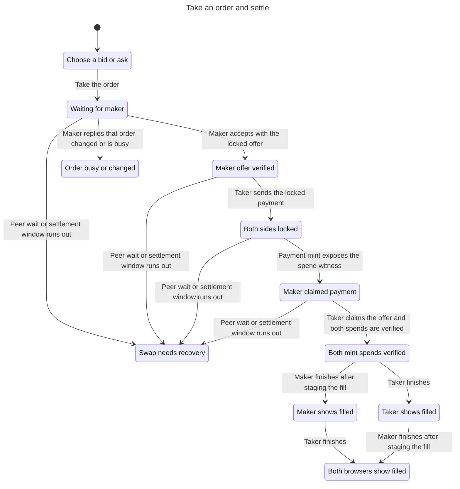
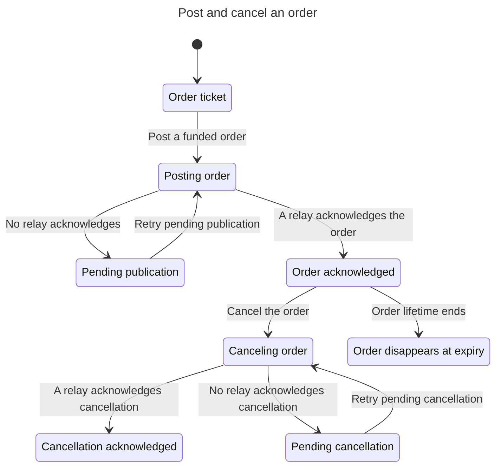
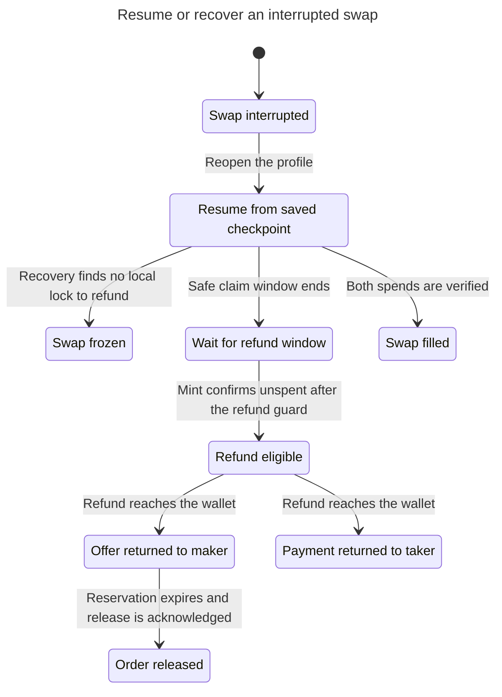
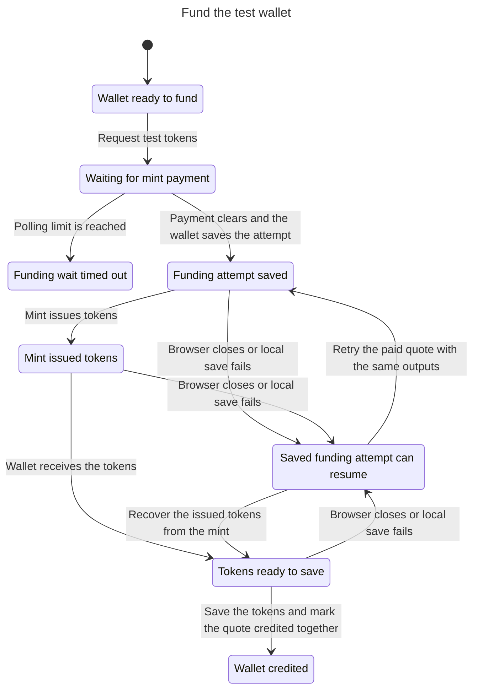

# Granola user flows

These four charts were generated with pstack `/statechart` from bounded TLA+ models. Each report records the checked rules and any shortest counterexample.

## Take an order and settle

The maker and taker can finish in either order. The chart hides relay publication and terminal stuttering. The model covers the direct three-message route and abstracts exact mint observations, messages in flight, partial fills, and the publication retry loop.

[Mermaid source](take-order/chart.mmd) · [TLC report](take-order/report.md) · [TLA+ model](take-order/TakeOrder.tla)



## Post and cancel an order

A failed publication leaves an exact signed event to retry. The chart hides terminal stuttering. The model covers one order, one aggregate relay ACK, and clock-based hiding at expiry.

[Mermaid source](post-order/chart.mmd) · [TLC report](post-order/report.md) · [TLA+ model](post-order/PostOrder.tla)



## Resume or recover an interrupted swap

A successful maker refund can be followed by an acknowledged order release. Payment returned to the taker describes wallet credit, since the public trade phase has no separate refunded value. The chart hides clock ticks, evidence acquisition that keeps the same label, and terminal stuttering. The model assumes a recoverable checkpoint and abstracts mint outages and proof contents.

[Mermaid source](recover-swap/chart.mmd) · [TLC report](recover-swap/report.md) · [TLA+ model](recover-swap/RecoverSwap.tla)



## Fund the test wallet

Granola saves the exact issuance outputs before asking the mint for tokens. After an interruption, retrying a paid quote uses the saved outputs. Retrying an issued quote restores the signatures for those outputs. The wallet balance and quote credit marker update together. The chart hides terminal stuttering and models one quote with repeatable interruptions.

[Mermaid source](fund-wallet/chart.mmd) · [TLC report](fund-wallet/report.md) · [TLA+ model](fund-wallet/FundWallet.tla)



## Regenerate

The charts were generated with the official pstack statechart at Cursor plugins commit `5866df557357d005b3c0c9d3da0d9e739b4bdde3` and TLC 1.7.4. Set `PSTACK_STATECHART` to the absolute path to the skill's `scripts/statechart.ts`. Use Node 24 and set `TLA2TOOLS` and `JAVA` to the checker jar and Java binary. Start from the repository root.

```sh
scratch=$(mktemp -d)
cp docs/verification/flows/take-order/{TakeOrder.tla,TakeOrder.cfg,view.mjs} "$scratch/"
node "$PSTACK_STATECHART" "$scratch/TakeOrder.tla" \
  --view "$scratch/view.mjs" --out "$scratch/result"
```

Use the matching module and folder for each flow. The command writes `chart.mmd` and `report.md`.
